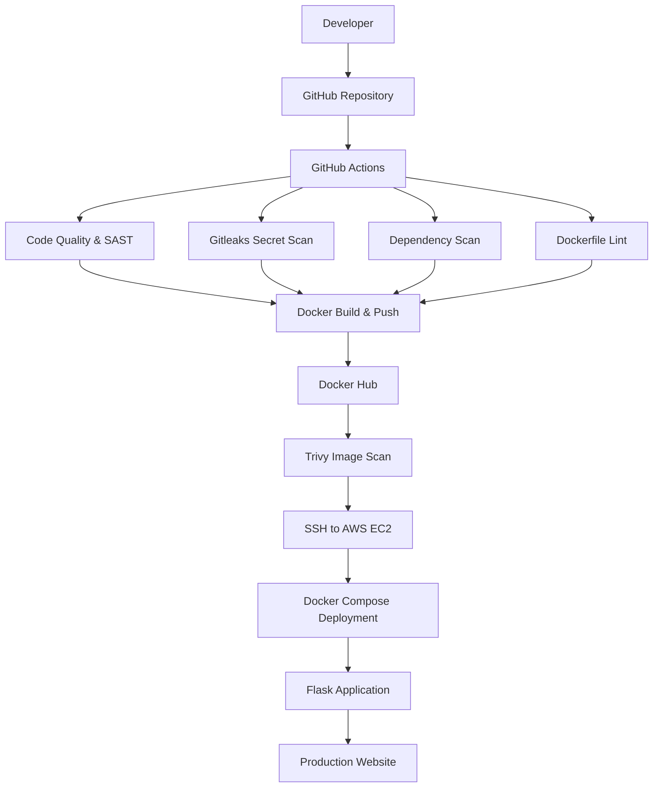

# 🚀 DevSecOps End-to-End CI/CD Pipeline | AWS EC2 | Docker | GitHub Actions

<p align="center">
  
  
  
  
</p>

<p align="center">
  <b>Automated CI/CD Pipeline with Integrated DevSecOps Security</b>
  <br>
  Build • Scan • Secure • Deploy • Monitor
</p>

---

## 🌟 Project Overview

This project demonstrates an **End-to-End DevSecOps Pipeline** that automates application building, code quality validation, security scanning, Docker image creation, vulnerability assessment, and production deployment.

The pipeline is implemented using **GitHub Actions** and deploys a Python Flask application on an **AWS EC2 instance** using Docker and Docker Compose.

Security is integrated throughout the CI/CD lifecycle to identify potential vulnerabilities before deploying the application to production.

### 🎯 Project Objectives

- Automate Continuous Integration and Continuous Deployment.
- Integrate code quality and static application security testing.
- Detect exposed secrets using Gitleaks.
- Scan project dependencies for known vulnerabilities.
- Validate Dockerfiles using linting tools.
- Scan Docker images using Trivy.
- Automate production deployment through SSH.
- Deploy containerized applications on AWS EC2.
- Maintain a repeatable and secure deployment workflow.

---

## 🏗️ Architecture



---

## 🔄 CI/CD Pipeline Workflow

The pipeline is divided into seven major stages.

| Stage | Job | Purpose |
|---|---|---|
| 1 | Code Quality | Validate source code and run quality checks |
| 2 | Secrets Scan | Detect exposed credentials using Gitleaks |
| 3 | Dependency Scan | Identify vulnerable dependencies |
| 4 | Docker Scan | Validate Dockerfile using linting |
| 5 | Build & Push | Build and publish Docker image |
| 6 | Trivy Scan | Scan Docker image for vulnerabilities |
| 7 | Deploy | Deploy application to AWS EC2 using SSH |

### 1. Code Quality & SAST

- Run code quality and linting checks.
- Perform Static Application Security Testing (SAST).
- Identify potential coding and security issues.
- Validate code before the Docker build stage.

### 2. Secret Detection – Gitleaks

Gitleaks is integrated to identify accidentally exposed sensitive information.

- API keys
- Passwords
- Access tokens
- Credentials
- Sensitive information committed to Git

### 3. Dependency Vulnerability Scanning

Analyze application dependencies to identify known security vulnerabilities and potentially insecure packages.

### 4. Dockerfile Linting

Validate the Dockerfile using Hadolint or the configured Docker linting tool.

Checks include:

- Dockerfile best practices.
- Incorrect instructions.
- Security-related configuration.
- Image optimization recommendations.

### 5. Docker Build & Push

- Build the Flask application Docker image.
- Tag the image using the GitHub commit SHA.
- Authenticate with Docker Hub.
- Push the image to the Docker Hub repository.

**Docker Image Repository:**

https://hub.docker.com/r/pandey17/github-actions-app

### 6. Docker Image Security – Trivy

Trivy is used to scan the generated Docker image.

It helps identify:

- Operating system package vulnerabilities.
- Application dependency vulnerabilities.
- Known CVEs.
- Container image security issues.

### 7. Automated Production Deployment

After the image scanning stage completes successfully:

1. GitHub Actions establishes an SSH connection to AWS EC2.
2. Docker and Docker Compose are installed or verified.
3. The Docker Compose configuration is transferred to the production server.
4. GitHub Actions authenticates with Docker Hub.
5. The production server pulls the commit-specific Docker image.
6. Docker Compose starts the updated application.
7. Application availability is checked.

---

## 🛠️ Technology Stack

| Category | Technologies |
|---|---|
| Cloud Platform | AWS EC2 |
| CI/CD | GitHub Actions |
| Version Control | Git, GitHub |
| Containerization | Docker |
| Container Registry | Docker Hub |
| Container Deployment | Docker Compose |
| Programming Language | Python |
| Web Framework | Flask |
| Application Server | Gunicorn |
| Operating System | Ubuntu Linux |
| Code Quality | Linters |
| SAST | Static Application Security Testing |
| Secret Scanning | Gitleaks |
| Dependency Security | Dependency Scanner |
| Dockerfile Validation | Hadolint / Docker Linter |
| Image Vulnerability Scanning | Trivy |
| Remote Deployment | SSH |

---

## 📂 Project Structure

```text
github-action/
│
├── .github/
│   └── workflows/
│       │
│       ├── devsecops-pipeline.yml
│       ├── cicd.yml
│       ├── code-quality.yml
│       ├── dependency-scan.yml
│       ├── secrets-scan.yml
│       ├── docker-lint.yml
│       ├── docker-build-push.yml
│       ├── image-scan.yml
│       └── deploy-to-server.yml
│
├── templates/
│   └── index.html
│
├── app.py
├── Dockerfile
├── docker-compose.yml
├── requirements.txt
└── .trivyignore
```

---

## 🐳 Docker Configuration

### Dockerfile

The Flask application is containerized using Python 3.13 Slim.

```dockerfile
FROM python:3.13-slim

WORKDIR /app

COPY requirements.txt .

RUN pip install --no-cache-dir -r requirements.txt

COPY . .

EXPOSE 80

CMD ["gunicorn", "--bind=0.0.0.0:80", "app:app"]
```

### Docker Compose

```yaml
services:
  web:
    image: ${DOCKERHUB_USER}/github-actions-app:${DOCKER_TAG}
    container_name: flask-app
    ports:
      - "80:80"
    restart: unless-stopped
```

The Docker image is tagged using the GitHub commit SHA to support version-specific deployments.

---

## ☁️ AWS EC2 Deployment

The production environment runs on an AWS EC2 Ubuntu instance.

**Deployment Components:**

- AWS EC2 – Application hosting.
- Ubuntu – Server operating system.
- Docker – Application containerization.
- Docker Compose – Container deployment.
- SSH – Secure remote server connection.
- Security Groups – Network access control.

**Deployment Flow:**

```text
GitHub Actions
      |
      | SSH Authentication
      v
AWS EC2 Instance
      |
      v
Docker Hub Authentication
      |
      v
Pull Docker Image
      |
      v
Docker Compose Up
      |
      v
Flask + Gunicorn
      |
      v
Production Application
```

---

## 🔐 GitHub Actions Secrets & Variables

The deployment workflow uses GitHub Actions Secrets and Variables.

### Repository Secrets

| Secret | Purpose |
|---|---|
| `EC2_SSH_HOST` | EC2 public IP address |
| `EC2_SSH_USER` | EC2 SSH username |
| `EC2_SSH_PRIVATE_KEY` | SSH private key |
| `DOCKERHUB_TOKEN` | Docker Hub authentication token |

### Repository Variables

| Variable | Purpose |
|---|---|
| `DOCKERHUB_USER` | Docker Hub username |

**Security Best Practices:**

- Never hardcode passwords or private keys.
- Store credentials in GitHub Secrets.
- Use SSH key-based authentication.
- Avoid committing `.env` files and sensitive credentials.
- Scan repositories for accidentally exposed secrets.

---

## 📊 Pipeline Execution

The DevSecOps workflow has been successfully executed through GitHub Actions.

**Verified GitHub Actions Run:**

| Detail | Result |
|---|---|
| Workflow | DevSecOps End to End Pipeline |
| Run Number | #29 |
| Commit | `f97d547` |
| Branch | `main` |
| Execution Time | 1 minute 48 seconds |
| Overall Status | SUCCESS |

The following jobs completed successfully in the recorded execution:

- Code Quality
- Secrets Scan
- Dependency Scan
- Docker Scan
- Build & Push
- Trivy Image Scan
- Production Deployment

**View Workflow Execution:**

https://github.com/priyanshupandey20/github-action/actions/workflows/devsecops-pipeline.yml

---

## 🚀 Live Application

The Flask application is deployed on AWS EC2 through the automated CI/CD pipeline.

**Application Status:** Production Deployment Successful

**GitHub Repository:**

https://github.com/priyanshupandey20/github-action

**Docker Hub:**

https://hub.docker.com/r/pandey17/github-actions-app

**GitHub Actions:**

https://github.com/priyanshupandey20/github-action/actions

---

## ⚙️ How to Run This Project Locally

### 1. Clone the Repository

```bash
git clone https://github.com/priyanshupandey20/github-action.git

cd github-action
```

### 2. Install Dependencies

```bash
pip install -r requirements.txt
```

### 3. Build Docker Image

```bash
docker build -t github-actions-app .
```

### 4. Run Docker Container

```bash
docker run -d \
  --name flask-app \
  -p 80:80 \
  github-actions-app
```

### 5. Access Application

```text
http://localhost
```

---

## 💡 Key Learning Outcomes

Through this project, I gained hands-on experience with:

- Designing an end-to-end DevSecOps CI/CD workflow.
- Implementing reusable GitHub Actions workflows.
- Automating code quality and security validation.
- Integrating Gitleaks for secret detection.
- Performing dependency vulnerability scanning.
- Building and publishing Docker images.
- Using Trivy for container image security scanning.
- Managing GitHub Actions Secrets and Variables.
- Configuring SSH-based production deployment.
- Deploying Flask applications on AWS EC2.
- Automating application deployment with Docker Compose.

---

## 👨‍💻 Author

**Priyanshu Pandey**

Aspiring AWS Cloud Engineer | DevOps & DevSecOps Enthusiast

- GitHub: https://github.com/priyanshupandey20
- LinkedIn: https://www.linkedin.com/in/priyanshupandey-p/
- Portfolio: https://mitmedia.site/portfolio

---

<p align="center">
  <b>🚀 Building Secure Applications Through Automation</b>
  <br>
  <i>Automate Everything. Secure Every Stage. Deploy with Confidence.</i>
</p>